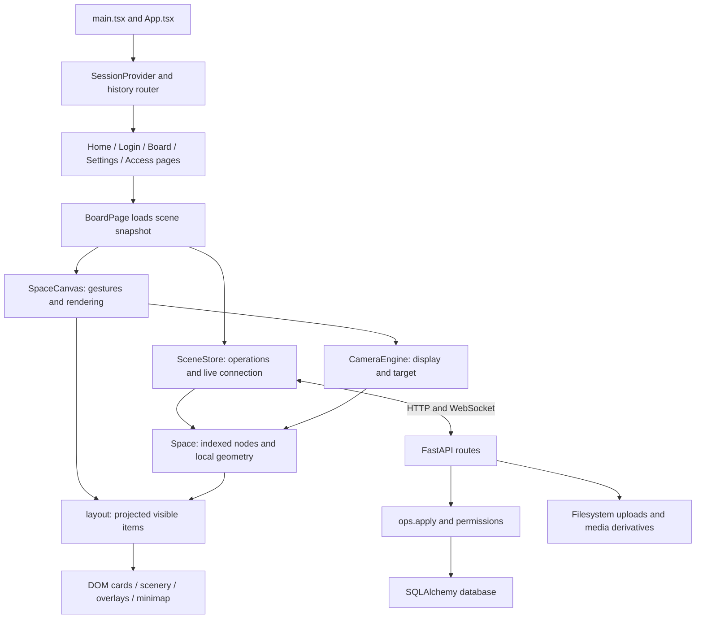

# Zoomz codebase overview

This reference describes the source inspected on 2026-10-17. Application code was not changed during onboarding. Earlier prototype requirements are not evidence of current functionality. Subsequent deployment changes are summarized below; current operational commands and acceptance blockers are in [README.md](../README.md).

Deployment additions include strict production configuration, safe SMTP errors and token-free mail logs, Docker/nginx packaging, standard `compose.production.yml`, pinned backend runtime dependencies, CI, and paired database/media backup/recovery tooling. Production requires PostgreSQL, HTTPS, explicit SMTP encryption, and writable persistent media. Durable WebSocket edits recheck membership, drag/presence payloads are validated, and database operations lock the space before mutation. No canvas or visual behavior was changed. The Zenith-specific manifest follows the official published schema and maps instance SMTP built-ins explicitly. The target server's admission, SMTP delivery, volume ownership, ingress details, and independent recovery remain unverified. The root image combines nginx, frontend assets, and one Uvicorn worker because Zenith supports one source build; PostgreSQL is a separate workload.

## 1. Application structure

The frontend is a client-rendered React 19 application written in TypeScript. Vite builds it, Tailwind v4 supplies utilities, and custom CSS defines the Zoomboard appearance. Conventional dialogs, menus, tooltips, and breadcrumbs use shadcn wrappers around Base UI. Motion animates tactile cards. A separate FastAPI service supplies accounts, scenes, files, sharing, search, and live collaboration.



### Entry points and responsibilities

Paths in this section are relative to the repository root.

| Module | Responsibility and relationships |
| --- | --- |
| `frontend/index.html`, `frontend/src/main.tsx` | HTML shell, Google Fonts links, global CSS, error-reporting installation, and React StrictMode root. |
| `frontend/src/App.tsx` | Tooltip, toast, and session providers. `Routes()` selects pages through the small history-API router. |
| `frontend/src/app/router.tsx` | `navigate()`, `useLocation()`, `match()`, and client-side `Link`. There is no React Router dependency. |
| `frontend/src/app/session.tsx` | Loads `/api/me` and auth configuration, exposes user state and sign-out. |
| `frontend/src/pages/BoardPage.tsx` | Loads a demo or live snapshot, creates/closes `SceneStore`, and composes `SpaceCanvas`, `TopBar`, sharing, search, status, and peer-follow controls. |
| `frontend/src/lib/types.ts`, `scene.ts` | Scene union, snapshot-independent indexing, ancestry paths, bounds, and display titles. `previewImages()` exists but does not generate the canvas's live board previews. |
| `frontend/src/lib/space.ts` | Mutable scene index, hierarchy edits, cached board windows/transforms, camera conversions, perspective projection, culling, and layout-derived focus. |
| `frontend/src/lib/cameraEngine.ts` | Framework-independent camera animation and direct manipulation. |
| `frontend/src/components/space/SpaceCanvas.tsx` | Main interaction coordinator, on-demand frame loop, card rendering, gesture state, editing, selection, resize, clipboard, upload placement, and navigation. |
| `frontend/src/components/space/Overlays.tsx`, `Scenery.tsx` | Screen-space text editor, marquee, remote cursors, and procedural scenery rendering. |
| `frontend/src/components/zoomboard/` | Custom spatial cards and tactile controls. Also contains minimap, movable panels, creation dialog, and Add menu. |
| `frontend/src/components/ui/` | Base UI-backed shadcn primitives. These are distinct from the custom Zoomboard `Button` and spatial cards. |
| `frontend/src/lib/http.ts`, `api.ts` | JSON requests, typed API errors, XHR uploads with progress, API URL prefix, and demo retrieval. |
| `backend/app/main.py` | FastAPI assembly, demo Pydantic contract, health, request guards, static assets, startup, and housekeeping. |
| `backend/app/models.py`, `db.py` | SQLAlchemy schema, engine, and request sessions. SQLite enables foreign keys; PostgreSQL uses a pooled engine. |
| `backend/app/ops.py` | Content/geometry validation, permission checks, atomic edits, sequence numbers, operation log, serialization, and replay. |
| `backend/app/live.py` | WebSocket rooms, acknowledgements, presence, transient drags, missed-operation replay, and kicks. Rooms are process-local. |
| `backend/app/spaces.py`, `permissions.py` | Space snapshots and metadata, membership, invitations, public/join links, and inherited board access. |
| `backend/app/auth.py`, `account.py` | Magic-link and optional Google login, cookie sessions, personal/team workspaces, profile, export, and account deletion. |
| `backend/app/files.py`, `media.py`, `storage.py` | File upload/serving/copy, classification and sanitization, derivatives, quota checks, and storage paths. |
| `backend/app/discover.py`, `security.py`, `mail.py`, `ratelimit.py` | Search and URL metadata, signed URLs/token hashes, SMTP or development logging, and in-process rate limits. |

`HomePage` lists personal/team spaces and shared spaces and creates new spaces or teams. `LoginPage` handles email-link sign-in and conditionally offers Google. `AccessPages` resolves public links and invite/join acceptance. `SettingsPage` edits profile, exports data, and deletes an account. Legal pages explicitly identify their text as draft.

Routes include `/login`, `/demo`, `/`, `/b/:id`, `/settings`, `/p/:token`, `/invite/:token`, `/join/:token`, `/terms`, and `/privacy`. Protected routes wait for session loading and redirect unauthenticated users. Nested-board navigation stays inside a board page; it is not browser route navigation.

## 2. Scene entities and state ownership

`Scene` is `{ rootBoardId, nodes: SceneNode[] }`. Each node is an independent entity with `id`, `parentId`, board-local `x`, `y`, `w`, `h`, and optional `z`. The discriminated union has five variants:

| Type | Content |
| --- | --- |
| `BoardNode` | `title`, optional `description`, optional `frame: {x,y,w,h}`. |
| `ImageNode` | Required `title`, `src`, and `alt`, plus optional `FileFacts`. There is no separate optional caption field. |
| `NoteNode` | `title` and `body`. |
| `FileNode` | `title`, `src`, `mime`, `size`, and optional `FileFacts`. PDFs, videos, and other files use this variant. |
| `LinkNode` | `url`, optional title/description/image/site/embed. |

`FileFacts` includes `fileId`, MIME/kind/size/status, intrinsic dimensions, thumbnail/poster/preview URLs, and client upload progress. Server serialization derives file facts from `StoredFile`; signed URLs are not the durable file identity.

`indexScene()` builds `byId` and `children` maps. `Space` retains those maps and mutates them in place. Its `pos` map contains temporary drag positions, separate from stored node geometry. `setParent()`, `addNode()`, `updateNode()`, `upsert()`, `removeNode()`, and `reset()` maintain the working scene. `removeNode()` removes descendants and refuses the root.

`SceneStore` holds the same `Space` object across resyncs so camera references stay valid. It owns permissions, connection status, peers, pending operations, and bounded undo/redo history. React does not own an immutable copy of the entire scene.

`SpaceCanvas` owns transient selection, hover, press/drag/resize state, editing/creation dialogs, and short morphs. `CameraEngine` owns `display`, `target`, current flight, smoothed pointer, and accumulated scenery travel. Breadcrumb focus is a layout result, not persisted navigation state. Session/user state belongs to `SessionProvider`.

Backend `models.Node` stores the flat hierarchy and JSON content. `models.Space` is an account-level document containing a root board and a sequence number; it is not the same type as frontend geometry class `Space`. Workspaces contain these documents. Users, sessions, memberships, board overrides, invites, stored files, and operations have separate tables.

## 3. Camera and coordinate mathematics

### Floor coordinates and nested frames

`Cam = { b: string, x: number, y: number, s: number }` names one board's coordinate frame. `x/y` are screen-pixel translation, not the camera's world position. `s` is screen pixels per local unit.

For a floor point `p`, the unraised projection is:

```text
screen = p * s + t
local = (screen - t) / s
```

`SpaceCanvas.localAt()` implements this floor inverse after `Space.toFrame()`. Raised cards require the additional inverse described below.

`Space.boundsOf(boardId)` uses `BoardNode.content.frame` when present. Otherwise it caches `contentBounds()` of immediate children with 40 local units of padding, or an 800×600 empty default. Server-created boards have stored frames. The public demo contract does not expose frames and uses the fallback.

`Space.frameOf()` fits this internal content window into the board's outer card. The face has 14-unit horizontal padding, a 44-unit header, and 14-unit bottom padding. The uniform child-to-parent scale is:

```text
innerW = card.w - 28
innerH = card.h - 44 - 14
k = min(innerW / content.w, innerH / content.h)
parentPoint = a + childPoint * k
```

`a = (ax, ay)` includes card placement, padding, centering, and subtraction of the internal window's origin. Cached offsets exclude the live card position; `frameOf()` adds `Space.at(card)` on each call. `innerOrigin()` supplies the matching grid origin to `BoardCard`.

Camera conversion preserves the same floor projection:

```text
toChild: sChild = sParent * k; tChild = tParent + a * sParent
toParent: sParent = sChild / k; tParent = tChild - a * sParent
```

`toFrame()` walks ancestry and composes these operations for any two valid board frames. `globalScale()` converts local scale to root-relative magnification for the zoom readout. These helpers assume a connected, acyclic tree with valid positive board dimensions and content windows. Most client ancestry walks do not contain cycle guards.

### Re-anchoring and navigation focus

`Space.normalize()` re-anchors into a child when its outer card covers the entire viewport. It returns to the parent when the active card no longer covers the viewport. `covers()` checks all four edges. The loop permits at most 32 frame changes per call.

There are no separate inward/outward wheel thresholds, target-board pointer guards, dwell timers, or stored camera-history stack. Entry is geometric and can also result from panning. Child iteration order resolves overlapping covering boards. The data model supports arbitrary nesting, but traversal and server safeguards have practical limits.

`layout()` starts one board above `cam.b` when possible. It descends visible board faces and derives `Layout.focus` for breadcrumbs. A board can become the breadcrumb focus before it owns the camera frame: it must cover the screen center and reach `SPACE.focusSpan = 0.42` on both viewport axes. Selection remains independent.

There is no persistent selected-board dimming mode in this source. Opacity comes from preview reveal, inherited reveal, perspective fly-past fading, and temporary spawn effects. Only one ancestor level is retained around the camera frame; this is not an unlimited rendering of all surrounding ancestors.

### Raised cards and inverse projection

`z` is height above the parent floor, not a CSS z-index. Boards themselves use the flat frame mapping. Other nodes use `lift()`:

```text
height = z * frameScale
g = 1 / max(0.12, 1 - height / 1500)
dx = -pointer.x * height * 0.12
dy = -pointer.y * height * 0.12 * 0.7
screen = viewportCenter + (baseScreen - viewportCenter) * g + (dx, dy)
screenScale = frameScale * g
```

Pointer drift is zero when parallax is disabled. `localFromScreen()` reverses this projection before removing camera translation/scale. Cross-board drag uses this inverse to preserve the grab location. Nodes too close to or behind the virtual eye are skipped; perspective boosts between 2.0 and 3.2 fade out. This is intentional depth behavior, not a focus overlay.

### Fit, limits, and programmatic movement

`Space.fit()` contains the board's internal window inside the measured viewport with padding `{top:96,right:72,bottom:104,left:72}`. Available width and height have an 80px minimum. The top bar overlays the canvas rather than reducing its measured height, so the padding reserves space for chrome. `ResizeObserver` updates the actual canvas dimensions but does not automatically refit.

`clampScale()` limits local scale to 14 and root zoom-out to 0.35 times root fit. It corrects translation around viewport center when clamping. These limits apply through wheel/direct zoom methods, not every `flyTo()` call. Pan translation is unbounded.

`SpaceCanvas.flyToBoard()` fits the requested board. `flyToNode()` fits non-board node rectangles into 60% of both viewport dimensions, in the parent frame. It does not account for raised-card projection or use almost-fullscreen contain framing. Editable notes instead open the editor on double-click. Editable board title strips rename; board faces fly inward only below the focus-span threshold.

Back, Escape with no selection, ancestor breadcrumbs, and Fit all use board-fit flights. They do not restore a previously saved parent camera. The root breadcrumb returns to the root board. The top-bar Zoomz link goes to the account home page, not the root overview.

## 4. Rendering and animation

The main space is HTML/CSS, not Canvas2D, SVG-only, or WebGL. `layout()` produces a flat list of `Placed` records with screen position, scale, opacity, depth, LOD, reveal, and paint order. `Item` applies `translate(...) scale(...)` to a fixed-local-size outer DOM wrapper. Motion transforms the inner tactile face separately.

Board previews use the actual descendants and their transformed positions. They are sibling DOM items, not a cover collage or child DOM subtree clipped to the board. `BoardCard` draws the face, title, grid, and stack layers. When a board covers the screen, layout substitutes a screen-sized `room` floor for the oversized face to avoid giant textures.

Offscreen items are culled with a 160px margin. Board contents reveal between 56 and 120 screen pixels on the smaller card dimension. Recursion stops for culled or insignificant boards; there is no explicit renderer recursion-depth cap. Descendants can extend beyond an outer board face because they are not clipped by that face.

`lodFor()` uses each card's projected width, not a global zoom. Images use far/medium/close thresholds of 90/380px, notes 120/200px, and files 100/320px. Images always render an image; title and alt text appear at higher detail. Notes reveal body text only at close detail. `pick()` chooses 256px or 1024px derivatives, then the original, accounting for device pixel ratio. Semantic text branches mount/unmount; CSS defines LOD fade helpers, but the current image/note components do not wrap those branches with the helper classes. Geometry stays fixed, though the image's available area changes as caption rows appear.

### Shared camera engine

`CameraEngine.tick(now, dt)` advances flights, target-follow smoothing, pointer smoothing, and travel. `SpaceCanvas.kick()` schedules an on-demand rAF loop while motion or morphs remain active. Each step calls React `setFrame()`, recomputes layout, and reconciles items. This implementation does not bypass React for high-frequency camera transforms.

- `zoomAt()` updates the target around the pointer with `factor = exp(-deltaY * gain)`. Translation uses `p - (p - t) * factor` so the floor point under the pointer remains fixed before limits apply.
- `lerpCam()` interpolates logarithmic scale and weights center-point movement by inverse scale to retain a pure zoom's fixed point.
- Target-follow smoothing uses a frame-time-adjusted factor based on `CAMERA.follow = 0.18` per 16.67ms. Pointer smoothing uses 0.08.
- `flyTo()` converts the displayed camera into the destination frame, then interpolates with cubic ease-in-out. Duration is `min(1.6, 0.45 + 0.12 * abs(log2(scaleRatio)))` seconds.
- `panBy()` directly moves the displayed camera. `jumpTo()` is immediate. `glideTo()` follows a peer without a flight. Touch pinch uses `zoomNow()`.
- Wheel input interrupts flights. Pointer-down calls `stop()`. Another flight starts from the current display. `track()` converts frames before accumulating scenery travel, avoiding false travel from re-anchoring alone.

### Tactile and scenery motion

`TactileSlab` uses Motion spring targets for rest, hover, press, and drag. Hover tilts 6°/-4°, drag lifts 10px with 10° tilt and scale 1.03, and notes retain a -2° base rotation. Press takes 70ms. Release/drop uses the springs in `MOTION`; drops have deliberate bounce. Board stack layers fan using `STACK` and Motion. CSS controls shadows, button press feedback, minimap entry/exit, and other interface transitions.

`morph()` in `SpaceCanvas` scales transferred items around the fractional grab point, with a 320ms ease-out-back settle. Spawn effects take 420ms. Geometry translation still follows the pointer rather than a spring.

`lib/scenery.ts` defines Studio, Mountains, Clouds, Forest, Dunes, and Cosmos. Seeded SVG layer markup is cached with a bounded cache. `Scenery` projects a finite visible set of layers from unbounded camera travel; zoom travel advances 0.85 layers per natural-log scale unit. Memoized SVG contents remain static while wrappers move.

`useReducedMotion()` reads the system preference. It disables camera glide/flights, pointer parallax, morphs, and tactile tilt/bounce while retaining static depth. Reduced flights jump immediately, unlike the older design document's proposed fade. CSS also disables selected animations. There is no app-level Reduce Motion toggle, and not every later CSS animation has a reduced-motion override.

## 5. Interaction flow

`SpaceCanvas` delegates events through `[data-item]`, `[data-board-handle]`, `[data-resize]`, and `[data-no-drag]`. Pointer capture retains the gesture. A mutable `pressRef` carries immediate gesture state; React `press` supplies visual feedback. Viewport CSS prevents text selection and native touch scrolling; images disable browser dragging.

| Input | Actual behavior |
| --- | --- |
| Wheel | Non-passive handler prevents canvas scrolling, normalizes delta modes, caps delta to ±240, and calls `zoomAt()` at the canvas-relative pointer. Ctrl/Meta wheel uses a different gain. |
| Empty floor drag / middle-button drag | Direct pan. Board floors pan too; large boards move by their title strips, while small boards can be grabbed anywhere. Space+drag pan is not implemented as a global modifier. |
| Card click / drag | Item movement starts after a 4px threshold. Click selects; Shift/Meta toggles selection. Dragging an existing selected item moves the selected group. |
| Shift floor drag | Marquee intersection selection, with exclusions for low-opacity and large board faces. |
| Double-click | Editable note opens in-place editing. Editable board title edits its name. Small-enough board face flies to its contents. Images/files/links fly to their node rectangle. No image modal. |
| Resize handle | Selected editable item resizes directly. Images retain the card aspect ratio unless Shift is held. Boards have minimum dimensions. Final size is one undoable update. |
| Desktop file drop / paste | Adds files in the destination board. Paste also handles copied Zoomz subtrees, URLs, or plain text converted into a note. |
| Minimap | SVG shapes/images match immediate children and a flat viewport rectangle. Click flies to a point; dragging jumps continuously. It follows layout-derived focus. |
| Panel grip | Drags navigation, zoom, and minimap panels. Arrow keys move grips by 12px or 48px with Shift. Position is anchored to the nearest viewport corner. |

Keyboard handling ignores text entry and most open dialog/menu contexts. Arrows pan the canvas by 140px; `+/-` zoom; `0` fits the focused board. Escape clears selection, otherwise goes up. `N/B` create notes/boards, Delete/Backspace remove selection, Cmd/Ctrl+Z/Y provide undo/redo, Cmd/Ctrl+C/X copy/cut, Cmd/Ctrl+D duplicates, and Cmd/Ctrl+A selects immediate children. Cmd/Ctrl+K opens search. Tab reaches rendered items; Enter flies or edits notes, and Space on an item flies. This is not a Space-held pan mode. Pointer cancellation restores an in-progress drag or resize; Escape is not wired to drag cancellation.

### Cross-board dragging

`boardAt()` chooses the deepest visible board under the pointer with reveal at least 0.5, excluding dragged boards and their descendants. Editable targeting checks `store.canEdit()`. Equal-depth overlapping candidates retain the first matching layout item, rather than explicitly choosing the highest paint order.

During each item move, the destination immediately becomes the working parent through `Space.setParent()`. The node retains its local dimensions; changing frame scale changes its apparent size. `screenScaleIn()`, the fractional grab point, `localFromScreen()`, and a temporary morph keep it attached to the pointer. This is not a separate size-to-destination-area algorithm.

On release, `clampInto()` confines position to a non-root board's fixed window. Oversized items are centered rather than resized. The code restores original parents and clears transient positions before committing final rounded coordinates and parent changes, allowing the store to capture undo inverses. Pointer cancellation restores original parents/positions. Moving a board preserves descendant coordinates.

Visible boundaries allow transfers into, out of, and between boards. There is no edge-hover parent reveal, auto-pan, or drag navigation dwell. At deep zoom a user must make parent space reachable through existing camera controls/gestures.

### Paint order and hit testing

`layout()` sorts siblings by type rank: boards first, ordinary cards second, notes last. Within a rank, child-list order is retained. Depth-first traversal assigns `order`, and objects with perspective boost above 1.6 get an extra 10,000. DOM z-index follows that order; dragged items temporarily use 50,000 and disable their pointer events.

There is no explicit persistent stacking field, bring-to-front operation, layer context menu, or drag-start reordering. Reparenting appends to a destination's child list. The flat DOM does not enforce nested CSS stacking contexts for board descendants. DOM hit targets follow painted wrappers, but board-drop targeting uses its own geometry and depth rule.

## 6. Editing, networking, and persistence

`SceneStore.commit()` checks client permissions, records an inverse, applies local edits immediately, queues a sendable operation, and emits. Supported operations are create/update/delete/batch. Undo history holds up to 100 entries and is local to the open store; remote edits are not a shared undo stack. Clipboard helpers copy whole subtrees with new IDs and copy stored files through the backend when pasting across spaces.

Live stores connect to `/api/spaces/{id}/live?since=...`. The protocol sends operations with client IDs, presence, and transient drag positions. Incoming results upsert/remove nodes; matching client IDs acknowledge pending edits. Pending edits suppress older server changes to the same node. Rejection or a replay gap triggers `resync()`, which reloads a snapshot, reapplies pending operations, and clears undo/redo. Reconnect backoff grows from 600ms to 15s. Presence is throttled to 70ms and drag previews to 50ms. Only the primary card's drag is broadcast during group movement.

`live.py` authenticates cookie/public-token sockets, checks origins, and uses a process-local `Hub`. Operation application runs in a threadpool. `ops.apply()` validates fields and permissions, persists a transaction, increments `Space.seq`, and records resulting changes. REST `/api/spaces/{id}/ops` uses the same operation path, but frontend `SceneStore` sends edits over WebSocket rather than automatically falling back to REST.

Server validation restricts types, content fields, IDs, finite geometry, parent boards, root edits, and cyclic board transfers. Geometry values are clamped to allowed ranges. Batches contain 1–500 primitive operations; creates enforce a 5,000-child board limit. `Ctx.is_inside()` treats ancestry beyond 256 steps as invalid. Permissions combine the higher workspace/space role, then use nearest per-board overrides, except owners cannot be overridden. A snapshot returns all nodes and effective board roles; overrides control editing rather than hide content.

The server retains operation history for reconnects, with pruning to 3,000 per sufficiently active space and a replay limit of 2,000. `replay()` returns latest node state rather than reconstructing every historical intermediate state. Presence and drag previews are not durable.

Persistence differs by mode:

- Live scene content, parent relationships, positions, dimensions, and height persist in SQL. Uploaded originals and derivatives persist under `STORAGE_DIR`.
- `/demo` loads a cached read-only API fixture but permits local in-memory editing. Reload discards those edits. Local uploads use object URLs.
- `zoomz.scenery` stores a local scenery choice. Editable live spaces also persist scenery through a metadata PATCH. Viewers can keep a local choice.
- `zoomz.panel.v2.nav`, `.zoom`, and `.minimap` store floating panel offsets. Storage reads/writes catch errors, but validation is minimal.
- Camera state, selection, pending offline edits, and undo history are not persisted. There is no versioned local scene-override schema or Reset Demo action.

### Backend and assets

`auth.py` stores hashes of session and magic-link tokens. Sessions use the HttpOnly `zb_session` cookie with SameSite=Lax; secure cookies follow `PUBLIC_URL`. Magic links are single-use; development returns a link without SMTP but never logs its token. Production requires SMTP and exposes no development links. New accounts receive their own seeded Summer Light space. Google OAuth is conditional on credentials and uses state and PKCE.

Unsafe HTTP API requests require `X-Zoomz: 1`. `http.ts` adds the header, sends same-origin credentials, and uses XHR for upload progress. `VITE_API_BASE` can prefix HTTP URLs, but live WebSockets and some direct links/error reporting remain same-origin. Cross-origin operation is not uniformly implemented.

`files.py` streams uploads into generated space/file paths, enforces per-file limits, checks current disk usage, and creates database metadata. `media.py` classifies bytes, rejects executables, sanitizes SVG, and optionally scans with ClamAV. Pillow creates 256/1024 WebP previews; pypdfium2 renders PDF first pages. Optional system `ffmpeg` produces video posters/transcodes through a single-worker executor. Signed file URLs work without cookies until expiry; unsigned requests require space access. Serving applies sandbox/security headers. This is implemented functionality, not a completed security audit.

The bundled fixture contains 8 boards, 34 images, and 7 notes. Boards reach depth 3 below the root; leaf content reaches depth 4. The path root → Colour story → Sunset palette → Peach tones demonstrates four board levels. `backend/scripts/generate_fixture.py` produces deterministic local SVG illustrations and the checked-in JSON. The 34 assets are generated placeholder art, not architecture photographs. They load through `/api/assets/art/...`. The script writes fixture files and is not part of normal startup.

`main.startup()` creates SQLite tables and starts housekeeping. Production uses the checked-in Alembic migration. Housekeeping removes expired auth data, prunes operation logs, and removes old unreferenced uploads. Search, URL unfurling, SMTP, Google login, remote avatar images, link-preview images, and fonts can involve external services. Basic fixture art and procedural scenery do not require external image services.

## 7. Visual conventions

Runtime tokens are `frontend/src/styles/tokens.css`. The base is warm `#FAF7F3` with ink `#17131F`, white surfaces, and muted inset surfaces. Action colors are tomato `#FF8E72`, cobalt `#6E8BFF`, lemon `#FFD56E`, mint `#72D9A9`, and lilac `#C7AEFF`. Depth floors progress through warm neutral, peach, lavender, and mint, then clamp to the last tint for deeper levels.

Bricolage Grotesque is the display face, DM Sans is the UI/body face, and JetBrains Mono is the zoom readout. `index.html` requests them from Google Fonts with system fallbacks. Spacing tokens use a 4px base. Rounded slabs have a matte face, a colored pedestal side, and a soft tinted cast shadow. Images use neutral mats and `object-fit: cover`; their presentation can crop rather than contain the source aspect ratio. Notes are lemon with masking tape. Board stacks are lilac and mint.

`src/index.css` imports Tailwind, shadcn styling, tokens, then `zoomboard.css`, and maps tokens onto shadcn variables. Most custom classes use `zb-` names. Later rules in `zoomboard.css` override some earlier ported reference rules; reading an early selector alone can misrepresent current styling. Dark tokens follow system color preference, with CSS support for explicit light/dark classes. No theme toggle is exposed.

The board page is full-viewport with an overlaid application header, floating breadcrumbs, scenery/Add controls, minimap, and zoom controls. There is no separate oversized board heading above the canvas. Responsive rules reduce chrome at 1000px and 720px and hide the minimap at 720px. The account pages use scrollable page containers and responsive grids.

These are source-based observations. No current-app screenshot or interaction was verified in a browser during onboarding. Historical `docs/design-system/` previews explain visual intent but are not evidence that every described transition or prop exists in the live app.

## 8. Current capability inventory

“Implemented” here means an active source path exists, not that browser behavior was verified in this session.

| Capability | Classification | Evidence or limit |
| --- | --- | --- |
| Pan, pointer-centered wheel zoom, camera flights | Implemented | `CameraEngine` and canvas handlers; also touch pinch and keyboard pan. |
| Nested boards and live spatial previews | Implemented | `Space` frame conversions, `normalize()`, and recursive `layout()`. |
| Semantic zoom | Partially implemented | Size-based LOD and resolution selection exist; current text branches do not implement the documented full crossfade. |
| Images, notes, generic files, and links | Implemented | Five-variant scene union and active card render branches. |
| Selection and editing | Implemented | Single/multiple selection, marquee, note/board editing, creation, deletion, resize, clipboard, undo/redo. |
| Double-click camera movement | Partially implemented | Images/files/links frame to 60% before depth projection; editable notes edit instead. Board faces have a span guard. |
| Element dragging across visible boards | Implemented | Live reparent previews, inverse projection, commit/cancel, destination highlight. |
| Edge-assisted drag-out navigation | Not implemented | No dwell/edge-reveal handler. |
| Layer management | Partially implemented | Type-based paint order and temporary drag lift; no explicit persistent order or manual layer commands. |
| Captions | Partially implemented | Required image title is used as caption, and close detail adds alt text. No independent optional caption model. |
| Global display preferences | Partially implemented | Scenery choice exists; caption and image-border toggles do not. |
| Persistence | Partially implemented | Server-backed scenes/files persist; demo edits and offline queue do not survive reload. Only scenery/panel positions use local storage. |
| Minimap | Implemented | Live child shapes/images, viewport rectangle, click and drag camera positioning. |
| Keyboard navigation | Implemented | Canvas shortcuts, item focus/activation, panel movement, search controls. Full accessibility was not verified. |
| Image viewer | Not implemented | Images are inspected on canvas. File/link cards can expose explicit external Open actions. |
| Reduced motion | Partially implemented | System preference controls main camera/tactile/parallax behavior; no saved app toggle and incomplete coverage of later CSS animations. |
| Search, accounts, sharing, uploads, live peers | Implemented | Active pages, API routes, and WebSocket client/server. External integrations remain unverified here. |
| Spatial continuity, polish, and real-world performance | Unable to determine fully | Floor conversion math has tests; full browser movement and timing were not exercised. |

## 9. Strengths, confirmed gaps, and risks

### Architectural strengths

Geometry and camera code are independent of React and data loading. Explicit local frames make deep navigation and miniature rendering use the same layout. Stable server-side board windows prevent adding/moving content from automatically rescaling every preview. The mutable indexed scene avoids rebuilding the whole graph during a drag, and final moves become one undoable operation. Culling, thumbnail selection, an on-demand frame loop, memoized card faces, and cached scenery limit work. REST and WebSocket edits share server validation and database transactions.

### Source-established limitations and defects

- The minimap SVG preserves aspect ratio, but its pointer inverse scales the entire DOM rectangle independently on each axis. It does not subtract SVG letterboxing. Nonmatching map/content aspect ratios can therefore give incorrect click coordinates. This is a mathematical source finding, not a browser reproduction.
- `LiveBoard`'s `useSyncExternalStore` snapshot omits `store.unsaved` and peer view/cursor details. Emitting after those values alone change does not invalidate that snapshot. The saving indicator and peer-follow propagation can remain stale until an included field changes. `SpaceCanvas` has a separate subscription for redraws.
- LOD text visibility is conditional and can change the image area inside a fixed card. CSS fade helpers exist but are not attached to those current text branches.
- `flyToNode()` ignores perspective height and targets 60% of the viewport. It is not an aspect-aware fullscreen image viewer and does not enforce all wheel scale limits.
- `close()` closes the store socket but does not clear every pending timer. Client 4403/4404 and kicked states stop reconnection. Backend comments that role-change kicks “reconnect” do not describe the current frontend behavior; the kicked panel offers reload.

### Risks requiring targeted testing, not assumed failures

- `SpaceCanvas` is a large coordinator. Every moving frame recalculates recursive layout, sorting, maps, minimap geometry, and React wrappers. Memoized card faces help, but smoothness with large scenes has not been measured. Pointer movement also reads the viewport rectangle; wheel, map, and panel handlers have their own layout reads.
- The renderer has size/offscreen pruning rather than a fixed recursion limit. Flat DOM descendants are not clipped or isolated by ancestor cards. Future stacking changes must account for that representation.
- `Space` trusts internal hierarchy edits; most ancestry functions can loop on a malformed cycle. API and clipboard/live-message decoding largely use TypeScript casts rather than complete runtime schemas. Server operation validation is stronger than transient drag-message validation.
- `live.py` now validates transient drag coordinates, same-space board targets, cycle safety, and source/destination edit permissions before relay. Presence rejects invalid camera dimensions. Clients still temporarily change indexes for accepted previews before an authoritative operation.
- Multiple sockets apply operations through threadpool tasks. `ops.apply()` now locks and refreshes the space before node mutations and sequence allocation. A PostgreSQL concurrency test is included in CI; it is skipped on SQLite. Broadcast ordering, reconnect races, pending-edit replay, and duplicate delivery still need targeted testing.
- In-memory pending edits disappear on reload. Acknowledgement loss and replayed create operations need careful testing; operation IDs are not a durable backend deduplication protocol.
- Frame/bounds caches require disciplined invalidation. `updateNode()` invalidates board size changes; `upsert()` invalidates board data more broadly. Callers that change a stored frame locally must account for those differences.
- Local panel restore only checks basic numeric fields and a truthy corner. It does not fully validate finiteness or the corner enum. Scenery restore uses a cast with a theme lookup fallback.
- Images have no explicit `onError` replacement. Demo object URLs are not systematically revoked. Minimap images use original `src` rather than the thumbnail picker. Long sessions, large uploads, and missing assets need browser checks.
- Client/server node contracts are manually maintained. The demo Pydantic contract has only board/image/note and omits stored frames; live snapshots support five variants and file-derived fields. The frontend TypeScript configs do not enable `strict`.

No application bug was fixed during this analysis. Potential concurrency, accessibility, security, and performance issues above are not a substitute for their own tests or audit.

## 10. Configuration, commands, and verification

### Local setup contract

The repository has `frontend/package.json` and `frontend/package-lock.json`, not a root package manifest. Production and CI use Node 24 and Python 3.12. `requirements.txt` retains runtime ranges; `backend/requirements.lock` pins the tested runtime environment.

For a provisioned environment, these are the development commands:

```sh
cd backend
.venv/bin/uvicorn app.main:app --port 8000
```

```sh
cd frontend
npm run dev
```

Dependency provisioning would use a backend virtual environment with `requirements.txt` and `requirements-dev.txt`, and `npm ci` in `frontend/`. No provisioning or dependency changes were performed during onboarding.

Vite proxies `/api` to `http://127.0.0.1:8000`, configurable with `VITE_API_PROXY_TARGET`. The development proxy enables WebSocket forwarding; the preview proxy currently does not explicitly enable it. `VITE_API_BASE` prefixes selected frontend HTTP requests. Production nginx supplies route fallback and same-origin API/WebSocket proxying. The separate `zenith-compose.yml` follows the official published runtime contract; its env/storage declarations are rejected by npm CLI 0.1.4's stricter preview validator.

Backend settings are loaded once at import by `config.load_settings()`:

| Setting | Current default or role |
| --- | --- |
| `APP_ENV`, `PUBLIC_URL` | `development`, `http://localhost:5173`. Origin, login links, and cookie behavior use the public URL. |
| `DATABASE_URL` | SQLite at `backend/data/zoomz.db`; a PostgreSQL URL selects the other engine path. |
| `STORAGE_DIR` | `backend/data/files`. |
| `SECRET_KEY` | Generated per process in development; required in production. Signs file URLs. |
| `SESSION_DAYS`, `MAGIC_LINK_MINUTES` | 30 days and 20 minutes. |
| `SMTP_HOST/PORT/USER/PASSWORD/FROM`, `SMTP_FROM_NAME`, `SMTP_ENCRYPTION`, `SMTP_TIMEOUT` | Required production SMTP configuration, optional auth/display name, explicit encryption, bounded socket timeout. Development without a host exposes only response links. Legacy `SMTP_TLS` remains a development fallback. |
| `GOOGLE_CLIENT_ID`, `GOOGLE_CLIENT_SECRET` | Enable Google sign-in when configured. |
| `MAX_UPLOAD_MB`, `SPACE_QUOTA_MB` | 200MB per file; 5120MB per space. |
| `CLAMAV_ADDRESS`, `SENTRY_DSN` | Optional scanning and server error reporting. |
| `TEST_DATABASE_URL` | Test-fixture override; otherwise tests use a temporary SQLite database. Never point it at real account data. |

`PUBLIC_URL` is supplied explicitly; no Zenith-specific variable injection is assumed. `main.py` enables API docs in development at `/api/docs`. `/api/health` executes a database query, not just a process-liveness check. Startup checks media writability and creates tables for development SQLite. Production rejects SQLite; the container runs `alembic upgrade head` before serving. See README for required production SMTP, proxy, secret, database, and media settings.

### Existing test coverage

`frontend/src/lib/scene.test.ts` has 16 tests covering paths/preview-image collection, parent/child inverses, face bounds, entry/exit re-anchoring, arbitrary-frame conversion, depth reveal/fly-past, logarithmic interpolation, LOD, reparent/removal, inverse depth projection, and deterministic scenery/layer recycling. It does not test the DOM gesture path, store synchronization, persistent layers, fullscreen framing, interruption, or complete wheel-pointer invariance.

`backend/tests/test_api.py` covers health, fixture shape/depth/determinism, and served SVG assets. `test_platform.py` covers sign-in, profiles, operations, cycle/root guards, atomic batches, sharing/overrides, uploads/security boundaries, live broadcasts/replay, search, unfurling, teams, export, and deletion. These are source-inspected tests, not passing results from this environment. `conftest.py` selects temporary database/storage before app import and disables most rate limits except the marked test. One unfurl test also attempts a public YouTube metadata lookup.

Relevant commands, from each project directory:

```sh
# frontend/
npm test
npm run lint -- src
npm run build
# backend/
.venv/bin/python -m pytest -q
```

### Historical onboarding results

The checked environment had Node v23.11.0, npm 10.9.2, and Python 3.14.7. Neither `frontend/node_modules` nor `backend/.venv` existed. A leftover root `node_modules` supplied some frontend commands, with versions different from the frontend lockfile.

| Check executed | Actual result |
| --- | --- |
| `git status --short` and `git diff --stat` before documentation | No tracked edits. Preexisting untracked `.audit/`, `.vite/`, and `test-results/` were preserved. |
| `npm test` in `frontend/` | Passed all 16 tests using ancestor Vitest 4.1.12, not locked Vitest 5.0.5. This is limited evidence, not a clean-install verification. |
| `npm run lint -- src` in `frontend/` | Exit 127: `oxlint` not found. |
| `npm run build` in `frontend/` | Exit 2 during TypeScript checking: six missing Base UI module imports. Vite production bundling did not run. |
| `python3 -m pytest -q` in `backend/` | Exit 1: no `pytest` module. Backend tests did not execute. |
| Browser setup | The available browser runtime failed during initialization with a disallowed `node:process` import. No current-app browser verification occurred. |
| Local HTTP probe | The sandbox probe failed to connect; an approved retry returned no page body. It did not establish a working current-app session. |

No dependencies, manifests, lockfiles, application sources, or README were changed. No production build success, measured frame rate, browser appearance, or external integration success is claimed.

## 11. Safe extension points

These mappings identify likely change locations, not approved feature work.

| Future change | Existing modules affected and invariants |
| --- | --- |
| New scene content type | Extend `lib/types.ts`, `SpaceCanvas.renderCard()`/labels, card component, `lodFor()`, minimap, clipboard/search handling, and backend `ops.TYPES`/content validation. Keep the common board-local geometry contract and review the separate demo schema. |
| Canvas appearance | Runtime tokens, `zoomboard.css`, `Scenery`, and `scenery.ts`. Preserve measured viewport coordinates, transform origins, existing visual identity, and selection/focus indicators. |
| Image metadata or captions | `ImageNode.content`, `ImageCard`, server content allowlist/serialization, search text, upload title construction, and clipboard. Do not confuse title, alt text, signed URL, and durable file identity. |
| Camera animations or framing | `cameraEngine.ts`, constants, and canvas navigation callbacks. Preserve frame equivalence, pointer anchoring, raised projection, interruption, and reduced motion; add geometry/engine tests. |
| Drag-and-drop refinements | Canvas press lifecycle, `boardAt()`, `clampInto()`, morphs, `localFromScreen()`, store commits, and server parent validation. Preserve grab location, cancellation, undo inverse capture, and descendant arrangements. |
| Explicit stacking | Current `layout()` rank/order, `Item` z-index, DOM/drop hit testing, node types, operation patches, SQL model/migration, and snapshot ordering. `z` must remain physical height rather than being reused as layer order. |
| Board hierarchy operations | `Space` index mutations and caches, `SceneStore` inverse/apply/resync, clipboard subtree operations, backend `Ctx` validation, and board-role inheritance. Keep a single root, valid board parents, acyclic ancestry, and consistent IDs. |
| Local folder imports | Existing Add/drop/paste entry points and `SceneStore.addFiles()` can receive file selections. No folder access, watcher, or filesystem adapter currently exists. Browser file access and durable server file identity are separate concerns. |
| Persistence beyond the demo | Live persistence already exists through SQL and filesystem storage. Demo serialization would be new work. Changes to live storage affect `models.py`, Alembic, `ops.py`, snapshot loading, upload storage, and replay semantics. Keep transient camera/gesture state out of durable scene data unless explicitly designed otherwise. |

The geometry/camera modules and backend operation validator are the clearest boundaries for focused tests. `SpaceCanvas` and live synchronization are the most coupled areas and need end-to-end interaction checks when changed.
