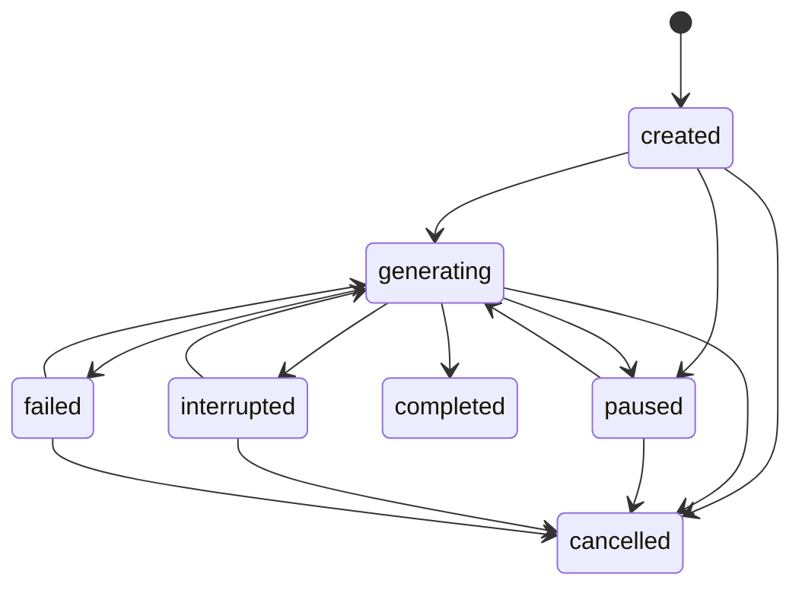

# MCP implementation reference

## Backend integration

`app/mcp_server.py` mounts the official Python SDK's stateless Streamable HTTP transport at `/mcp` inside the existing FastAPI lifespan. `app/mcp_access.py` owns OAuth and connection grants. `app/mcp_ui.py` exposes cookie-authenticated management, approvals, draft controls, sources, and recovery. `app/mcp_service.py` implements tools over existing `Node`, `Space`, uploads, and operations.

`ops.apply(..., commit=False)` permits the MCP service to commit scene changes, revision, retry result, approval consumption, and checkpoint together. Normal editor callers retain the default commit behavior. After commit, the existing `live.hub` publishes the same operation messages the editor already understands. Media derivatives use the existing upload processor. No separate scene representation, AI inference service, or gateway exists.

Alembic revision `a90b4a770001` adds OAuth clients, pending grants, connections, hashed credentials, tasks, retry records, approvals, and audit records. SQLite transactions use `BEGIN IMMEDIATE`; PostgreSQL uses row locks. PostgreSQL concurrency remains unverified locally.

The frontend adds `/ai` and `/mcp-connect`, a compact draft-status panel, and a selected-element source indicator. These follow existing editor controls. Camera and coordinate transforms are unchanged. The draft panel polls every three seconds outside the canvas render loop.

## Tools

Tool schemas returned by `tools/list` are authoritative. All tools require a resource-bound bearer token. Grants always intersect the user's current Zoomz permissions.

| Tool | Main inputs | Result and access |
| --- | --- | --- |
| `get_capabilities` | None | Types, limits, coordinate semantics, and unsupported capabilities; authenticated read |
| `list_workspaces` | `offset`, `limit` | Authorized workspaces and next cursor |
| `list_boards` | Optional `space_id`, pagination | Authorized boards, parent relationships, revision |
| `search_workspace` | `query`, optional `space_id`, pagination | Scoped search matches; query at most 200 characters |
| `get_board` | `space_id`, `board_id`, pagination | Board, immediate children, revision, page-local bounds, gaps, overlaps, editor URL |
| `get_element` | `space_id`, `element_id`, `text_offset`, `text_limit` | Geometry and content; note text in pages of at most 8,000 characters |
| `get_source_visual` | `space_id`, `file_id`, optional one-based `page` | Actual JPEG image plus structured source metadata; source must be linked under authorized boards and at most 25 MiB |
| `get_board_preview` | `space_id`, `board_id`, optional width/height and board-local `bounds` | Actual SpaceCanvas JPEG plus revision; scoped subtree, opt-in sandboxed Chromium |
| `create_moodboard` | `workspace_id`, `title`, `idempotency_key` | New normal root moodboard; workspace edit grant required |
| `apply_canvas_batch` | `batch` | Atomic changes, revision, server IDs, or structured conflict/approval response |
| `generation_task` | `action`, task or board IDs, objective/checkpoint/revision as applicable | Persisted task state; writes require edit rights |
| `upload_media` | Board IDs, filename, base64 bytes, key, revision, geometry, optional task | Existing image/file card and protected asset; at most 2 MiB decoded |
| `import_source_file` | Same target/geometry plus provider `file` object | Attachment transfer up to 25 MiB; explicit administrator host allowlist required |

Discovery returns at most 100 rows per page. Cursors are scan offsets, so a filtered page can be empty before the end. `get_board` truncates note bodies after 4,000 characters and marks `body_truncated`. Bounds and overlap results cover the returned page, not the entire board.

`get_board_preview` captures the actual renderer, including nested previews. Its optional `bounds` has x/y/w/h in the selected board's coordinates for closer inspection. Limits are 2,000 subtree nodes, 64 levels, 8 MiB serialized scene, 480–1,600 by 360–1,200 pixels, one active render, and a 25-second render deadline plus cleanup. No credentials reach Chromium. External resources are blocked; the isolated context receives only authorized scene/media data. Permissions are checked again before returning an image, so mid-render revocation discards it. Disabled or unavailable runtimes return a generic 503, and concurrent requests receive 429. The captured revision may become stale during rendering; inspect again before mutation.

## Batch contract

The MCP request body is limited to 3 MiB. Each batch contains 1–100 operations and requires `space_id`, `expected_revision`, and a stable `idempotency_key`. The optional `task_id` associates writes with a draft.

```json
{
	"space_id": "<existing space id>",
	"expected_revision": 0,
	"idempotency_key": "revision-topics-001",
	"operations": [
		{"type": "create", "ref": "topic", "node": {"type": "board", "parentId": "<root board id>", "x": 40, "y": 40, "w": 400, "h": 340, "content": {"title": "Graphs"}}},
		{"type": "create", "ref": "summary", "node": {"type": "note", "parentId": "$topic", "x": 40, "y": 40, "w": 380, "h": 280, "content": {"title": "Traversal", "body": "A queue visits vertices in breadth-first order."}}}
	]
}
```

Creation uses `ref` plus `node`; `$ref` resolves relationships within that batch. Updating uses `id` plus `patch`; deleting uses `id`. Updating an element created in the same batch requires a subsequent batch. Existing editor validation rejects unsupported types and cycles.

Note bodies accept at most 100,000 characters for both creation and updates; oversized bodies are rejected before any mutation. Geometry-only updates do not replace long existing note text.

Positions are board-local. `z` is elevation and `rank` is stacking. Dimensions must be 20–20,000; x/y/rank are bounded to ±1,000,000 and z to 0–400. Explicit numbers are preserved or rejected, never silently clamped by the MCP adapter. A board's `content.frame` remains its stable internal coordinate window. Existing node types are board, note, image, file, and link. Connector lines are not supported.

The retry ledger binds a key to the connection and canonical request, including revision. An identical successful retry returns previous IDs; different parameters under that key are rejected. Current access is checked again. A stale revision returns `revision_conflict` and `current_revision`. Inspect before retrying with a new key. Validation failures roll back the batch, not earlier batches. Media uses private staging and cleanup on failure.

Tool-level rejection returns `error`, `status`, and a generic `message`; schema errors return `invalid_request`. Approval and revision conflicts have distinct error values. Clients must inspect structured results, not only the MCP envelope's `isError`. Connection rate limiting allows 120 calls per minute with a 40-call burst; authentication endpoints use additional existing limits.

## Authentication and destructive changes

OAuth discovery is at `/.well-known/oauth-authorization-server`; protected-resource metadata is also available at `/.well-known/oauth-protected-resource/mcp`. Authorization uses public-client registration, exact callback matching, PKCE S256, short-lived one-use codes, opaque hashed tokens, a resource of `PUBLIC_URL/mcp`, rotating refresh tokens, and backend revocation checks. Access tokens last 15 minutes; refresh credentials last 30 days. Consent uses the normal Zoomz sign-in session and CSRF boundary. Client names are self-reported, not verified brands.

Callbacks require HTTPS except literal loopback HTTP addresses for native clients, including when the resource server runs in production. Arbitrary HTTP callbacks, fragments, credentials, whitespace, and control characters are rejected. Token revocation returns success for already revoked or unknown credentials without disclosing their state.

Selected workspaces are the default grant. Selected board subtrees and explicitly authorized all-access grants are alternatives. Viewer roles cannot edit; MCP cannot grant itself broader access. Tokens and credentials are not returned by connection-management APIs.

Deletion, edits affecting more than 20 existing elements, and substantial long-note replacement require elevated authorization. Replacement detection compares retained text tokens against the connection's saved baseline; it is a bounded heuristic, not semantic analysis. Default policy produces a ten-minute hosted approval bound to the exact request and revision. A plain `user_approved` argument is not accepted. Approval is single-use. The user can instead block destructive operations or explicitly elevate one task, up to 24 hours, or until revoked. The UI currently offers a one-hour time option.

Before a destructive commit, the backend saves the normal scene representation in an audit snapshot, capped at 5,000 nodes and an 8 MiB aggregate-content guard. Larger destructive requests are refused. Owner-only recovery requires a fresh revision and typed confirmation; recovery also saves the replaced state. Original assets referenced by recovery snapshots are retained by housekeeping. Database and media backups remain necessary.

## Generation lifecycle

Tasks persist objective, owner, target board, status, checkpoints, source availability, created IDs, and last revision/batch. No hidden reasoning or unbounded chat history is stored.



Interrupted tasks can also pause. Completed and cancelled tasks are terminal. Disconnection does not finalize a task. Creating the same objective/target through one connection returns its existing task.

Pause serializes with writes against the space and prevents subsequent AI mutations under that user's paused board, including attempts to omit `task_id`. Manual editor changes remain allowed. Resume, checkpoint, and finalization require the latest revision; pausing and cancellation do not require a fresh revision. Resume does not resume provider inference. A later conversation can list tasks, inspect the checkpoint and board, and continue using current revisions and available sources.

Checkpoints support `summary`, `completed_phases`, `outstanding_work`, `missing_sources`, and `available_sources`. They are bounded to 32,000 serialized characters. Task-associated mutations cannot escape the task board subtree. Concurrent PostgreSQL behavior and browser-visible progression still need acceptance verification.

## Sources and media

`content.references` accepts at most 20 entries. Each has classification `source`, `supplementary`, or `external`, plus optional title, filename, asset ID, page, slide, section, excerpt, URL, and availability. The backend validates structure and asset access, not factual citation accuracy. References do not execute instructions. Unavailable originals retain known metadata without invented links.

Protected PDF sources can open at a page fragment. `get_source_visual` returns a stored raster thumbnail or a selected PDF page as an actual MCP image, bounded to 1,600 pixels on the longest edge. It reuses Pillow/PDFium and serializes PDFium access with existing upload previews. The SDK test verifies image-result transport and two-page PDF selection, not provider image consumption. It neither renders moodboards nor verifies citations.

Slides retain metadata but do not have a native slide renderer. The existing uploader stores presentation/document originals; it does not automatically extract all PowerPoint diagrams or PDF pages into new cards. Client-selected images or extracted material can be uploaded as ordinary assets. Existing multi-file editor upload is the fallback; matches must be explicitly associated rather than silently guessed.

Remote attachment import is disabled by default. `MCP_SOURCE_HOSTS` is an exact host allowlist. The fetcher rejects private/reserved IPs, redirects, credentials, and non-HTTPS/non-443 targets, and pins the validated connection address while retaining TLS certificate verification. No arbitrary URL-fetch tool exists. Mocked transport tests do not prove a real ChatGPT or Claude attachment is transferable.

Body reads use bounded chunks and a twenty-second transfer budget, with remaining socket time reduced between reads. This rejects slow-drip responses instead of allowing each chunk a new full timeout. DNS resolution uses the system resolver; an end-to-end latency guarantee is not claimed.

## Current acceptance gaps

Rendered screenshots and MCP image transport pass real sandboxed Chromium tests locally. Full browser workflow acceptance, real-provider account workflows, PostgreSQL concurrency, and the current production container remain incomplete. See [PROGRESS.md](PROGRESS.md) for the evidence ledger. This reference describes implemented behavior, not a declaration that MCP v1 is complete.
